# Spoon Fight

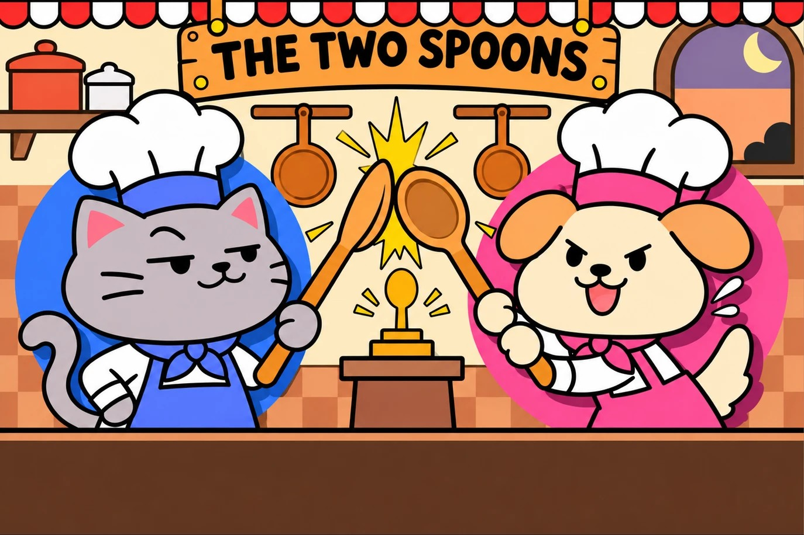

**You used to cook together. Now you're rivals.** Spoon Fight is a two-player online game about running a restaurant. Over 5 days you each run your own place: hire staff, race for food at the market, play ad cards (some for your own restaurant, some to trip up your rival), and serve guests live. The player with more money and stars at the end wins the Golden Spoon.

It's made for players aged 13 and up, as a fun way to learn the basics of running a business: costs add up every day, food goes bad, unhappy guests hurt your reputation, and every choice is a trade-off.

## Play it

| Where | Link |
| --- | --- |
| **GitHub Pages** | **https://paprikachen.github.io/cs377g_Project3/** |
| **itch.io** | **https://paprikachen.itch.io/spoon-fight** |

- **Two players, two devices.** Player 1 creates a room and shares the 4-letter room code (or the invite link). Player 2 types the code and joins. No account needed.
- **Practice alone**: on the first page, click "New here? Practice alone first" to play both restaurants on one screen.
- Best on a laptop or desktop browser (about 1440 × 900).
- Both players should use the same link (GitHub Pages or itch.io), since the two sites can run different versions.

## How a game works

You start with **$200 and 3 stars**. Your **score is your cash plus $20 for every star**. After day 5, the higher score wins.

### 1. Pick your restaurant

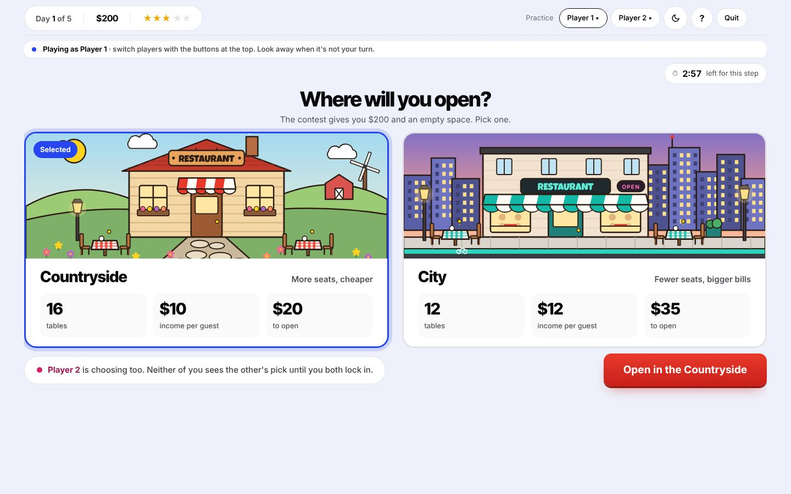

| | Countryside | City |
| --- | --- | --- |
| Tables | 16 | 12 |
| Each guest pays | $10 | $12 |
| Costs to open | $20 | $35 |
| Rent every morning | $5 | $12 |
| Each staff bunny costs a day | $14 | $18 |

The Countryside has more seats and lower costs. The City has fewer seats, but each guest pays more. Each place also gets its own ad cards.

### 2. Every day

| Step | What you do |
| --- | --- |
| **Ads** (from day 3) | Buy ad cards for your own restaurant, and cards that cause trouble for your rival. All cards stay face down until just before dinner. |
| **Staff** | Hire bunnies. Each one seats and serves the 2 tables in its section. Wages are paid every morning, and letting one go costs goodbye pay. Some mornings a secret shady deal shows up: easy money, but an inspector might catch you. |
| **Market** (from day 2) | You both shop at the same time for 60 seconds, racing for the same food bundles. **Express** food arrives today. **Regular** food is half the price but may not arrive until tomorrow. Bigger bundles are cheaper per plate. |
| **Service** | The restaurant runs live for 2 minutes. You are the chef: click guests at the door to seat them and click seated guests to serve them. Out of plates? Ride your bike (or scooter) to the farm (or market) for more, at a cost. Events can pop up: someone asks for free food, a fight breaks out, or a guest proposes. |
| **Vouchers** | Give a voucher to a guest who left unhappy so it doesn't count against your stars. |
| **Recap** | See your profit, why your stars changed, and how you stand against your rival. |

### 3. Stars and regulars

- Serve everyone (nobody leaves unhappy) and you gain a star. Guests who leave unhappy cost you 1 or 2 stars.
- Every star pays $20 into your cash at the end of each day, and counts again in the final score.
- Your stars decide how many regulars come the next day. A few good days bring a crowd; a few bad days empty the room. So a player who's behind can still catch up.

## Visuals

**The goal**: the story sets up the rivalry, then 4 short goal pages explain how to win.

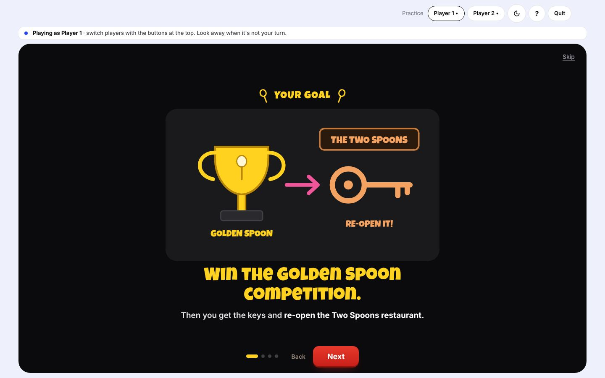

**Staff**: click a rug to hire a bunny for that section. The money panel shows what it costs.

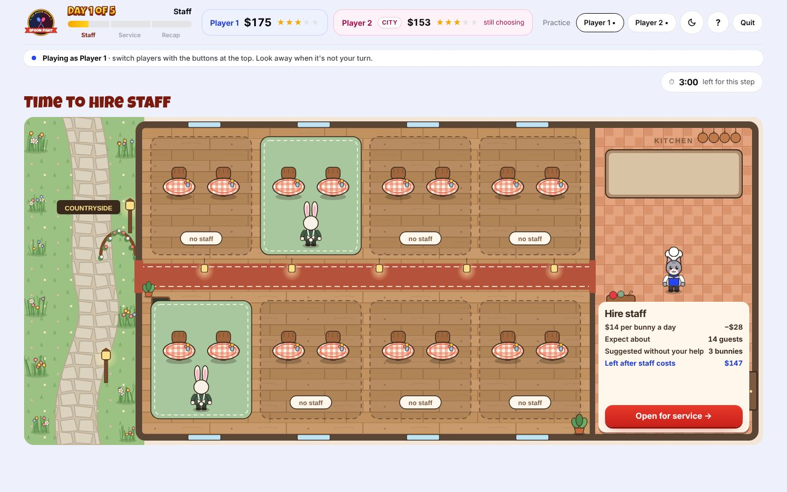

**Market**: a live race for food bundles. Your purchases are blue and your rival's are pink.

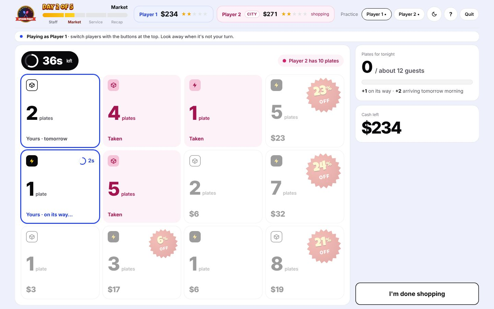

**Ads**: cards for your own restaurant (blue) and cards to play on your opponent (pink).

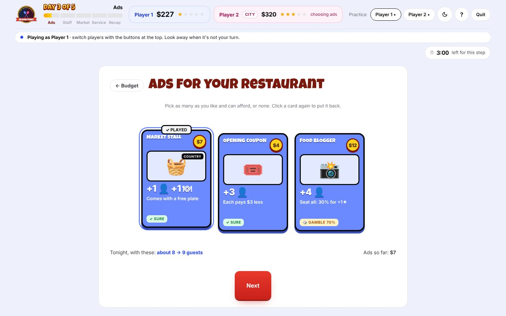
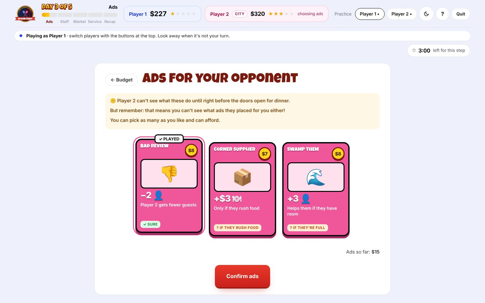

**Service**: the live restaurant. Guests from your ads wear your colour; guests your rival sent you (here, their "Swamp them" card) wear theirs.

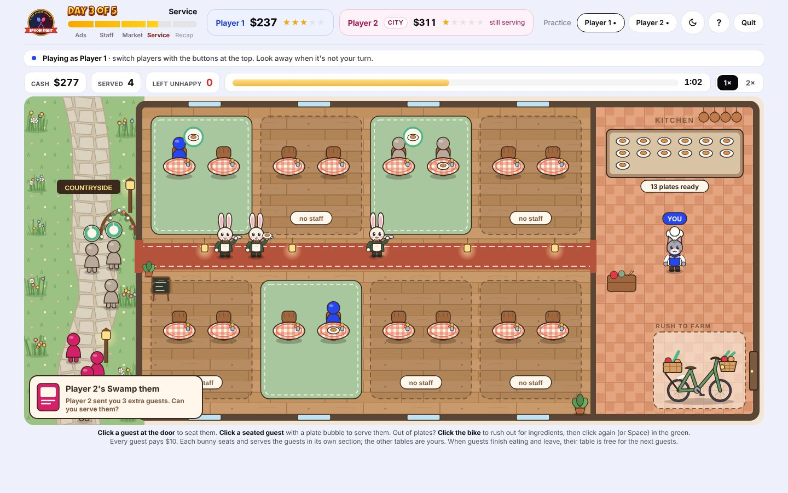

**Recap**: profit, stars, and the race with your rival.

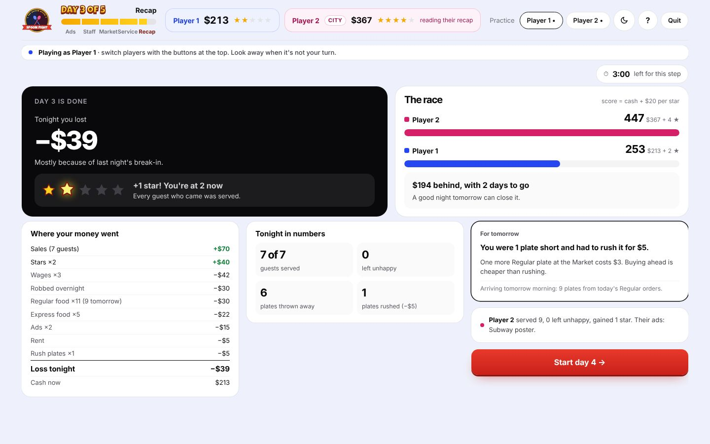

**Ending**: the judges count the score, then the winner gets the Golden Spoon and both players see a summary of the whole game.

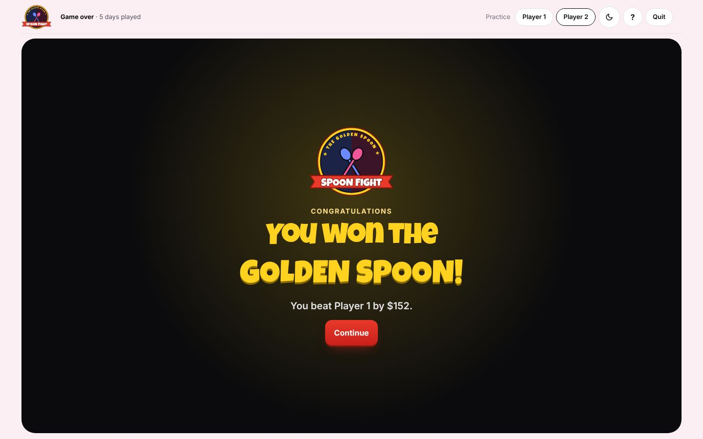
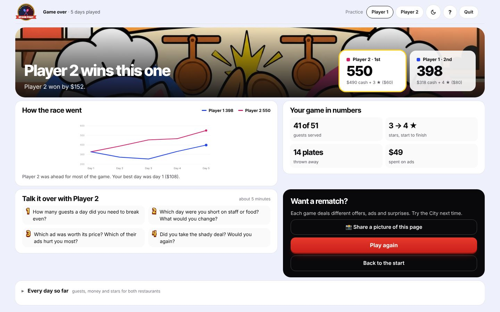

## About the project

A team project for CS377G (game design), built through many rounds of playtesting from a first prototype on Nov 4 to the final version on Nov 21, 2026. The game design (rules, numbers and ideas) is the team's own work. The code was written with the help of an AI coding assistant (Claude Code), directed and tested by the team.

## For developers

The game is a static web page (no server of our own). Online play uses Firebase: anonymous sign-in and Firestore.

| File | What it does |
| --- | --- |
| `index.html` | Entry page |
| `engine.js` | All game rules. Every number is in `CFG` at the top |
| `app.js` | Screens, online sync, practice mode |
| `service.js` | The live restaurant and the staff floor plan (generated from `tools/service/`, see `CLAUDE.md`) |
| `art.js` | Drawings: icons, cards, story and goal pictures |
| `style.css` | Styles, light and dark theme |
| `assets/`, `vendor/` | Images, and html2canvas for the Share button |
| `firebase-config.js` | Firebase web config (public values) |
| `firestore.rules` | Database security rules; paste into the Firebase console to publish |
| `tests/` | Automated tests |

**Run it locally.** The page uses ES modules, so start a local server instead of opening the file:

```bash
python3 -m http.server 8000
```

Then open `http://localhost:8000`.

**Tests** (run after every change):

```bash
node tests/engine.test.js
```

```bash
python3 tests/online.test.py http://localhost:8000/index.html
```

**Publishing.** Pushing to `main` updates GitHub Pages in about a minute. Other branches deploy to `https://paprikachen.github.io/cs377g_Project3/preview/<branch>/`. When a code file changes, bump the `?v=...` numbers in `index.html` so browsers load the new files. For itch.io, zip `index.html`, the `.js` files, `style.css`, `assets/` and `vendor/` (with `index.html` at the top level) and upload it as an HTML game.

**Changing rules.** Edit `CFG` in `engine.js`. Both players must run the same version, so change rules between games, not during one.

**Firebase setup** (already done for this project; only needed for a new Firebase project): turn on **Anonymous** sign-in under Authentication, create a Firestore database in production mode, publish `firestore.rules`, copy the web config into `firebase-config.js`, and add your site's domain under Authentication → Settings → Authorized domains. The free Spark plan is plenty: one game uses a few hundred reads and writes.

More detail on the architecture is in `CLAUDE.md`.
